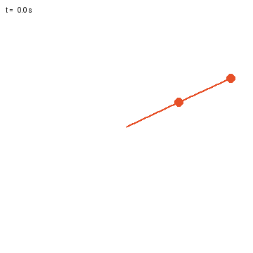
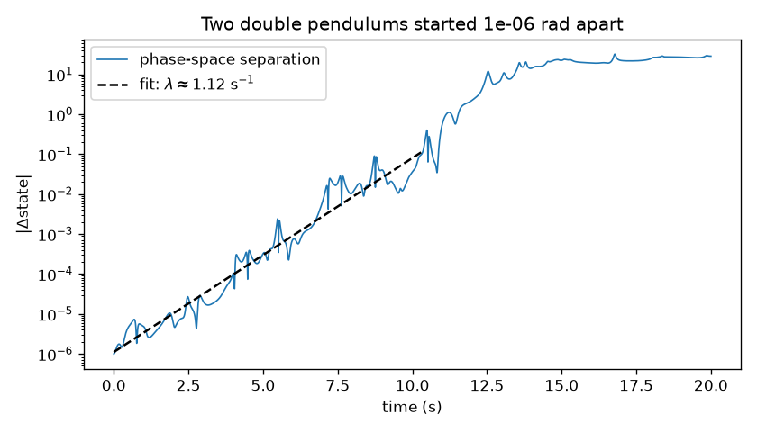

# Double-pendulum chaos

Two double pendulums start 1e-6 rad apart and end up doing completely different things within about 12 seconds. Integrated with a hand-written RK4; the log of their separation gives an estimate of the Lyapunov exponent.

[Preview](#preview) · [Equations of motion](#equations-of-motion) · [Setup](#setup) · [Run](#run) · [Divergence and energy](#divergence-and-energy) · [Tests](#tests)

## Preview



## Equations of motion

From L = T - V with Δ = θ1 - θ2 and D = 2m1 + m2 - m2 cos 2Δ, the Euler-Lagrange equations give:

```text
θ1'' = [-g(2m1+m2) sin θ1 - m2 g sin(θ1 - 2θ2) - 2 m2 sin Δ (l2 ω2² + l1 ω1² cos Δ)] / (l1 D)
θ2'' = [2 sin Δ ((m1+m2) l1 ω1² + (m1+m2) g cos θ1 + m2 l2 ω2² cos Δ)] / (l2 D)
```

## Setup

```bash
pip install -r requirements.txt
```

## Run

```bash
python pendulum.py
```

Takes about 15 seconds. It writes `pendulums.gif` and `separation.png`. `--t-end`, `--dt` and `--eps` change the run length, step size and initial offset.

## Divergence and energy



With m = l = 1, both arms starting at 2 rad and dt = 1e-3, the separation grows from 1e-6 to 0.1 in about 10 s, which fits to λ ≈ 1.1 s⁻¹. Energy drifts by about 1e-8 relative over 20 s. Past about 13 s the curve flattens out, since by then the two motions have nothing to do with each other.

## Tests

Install pytest separately from the runtime dependencies:

```bash
pip install pytest
```

```bash
python -m pytest -q
```

The tests check that RK4 conserves energy to 1e-5 at dt = 1e-3, and that starting in each small-angle normal mode (θ2 = ±√2 θ1) oscillates at ω² = (2 ∓ √2) g/l within 1%.
